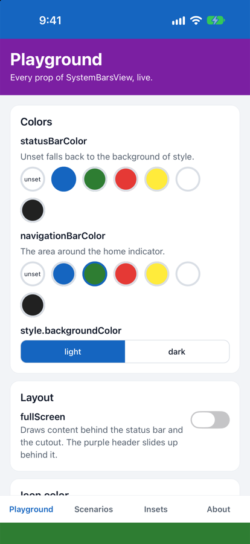
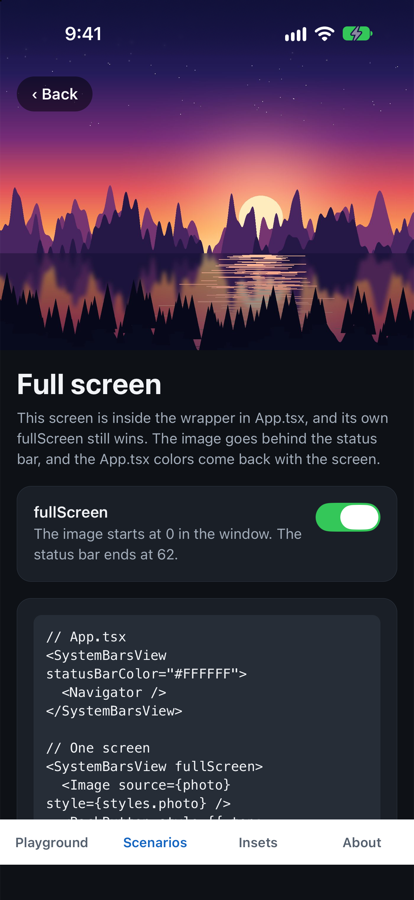
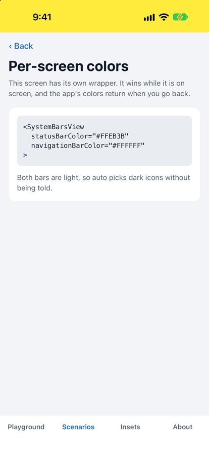
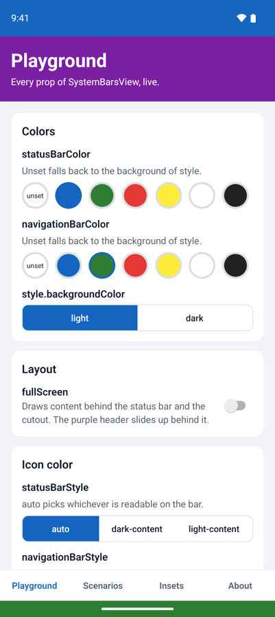
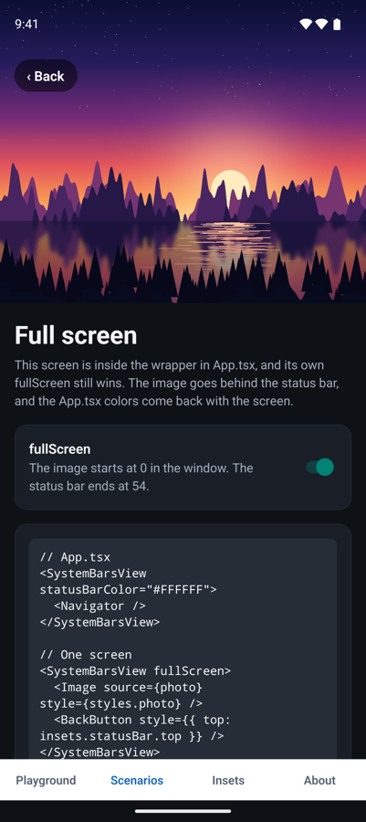
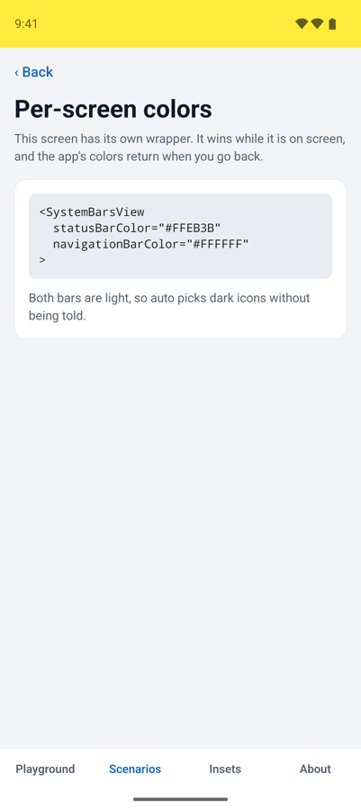
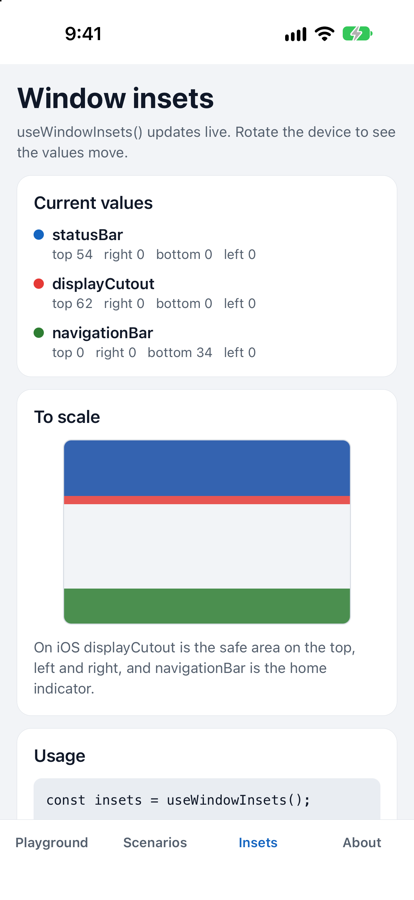

<div align="center">

# react-native-window-safe-area-insets

**Color the system bars, keep content clear of them, and read the window insets.**<br>
One view and one hook for React Native on Android and iOS.


[](LICENSE)

<table>
  <tr>
    <th></th>
    <th>Bar colors</th>
    <th>Full screen</th>
    <th>Per-screen colors</th>
  </tr>
  <tr>
    <th>iOS</th>
    <td></td>
    <td></td>
    <td></td>
  </tr>
  <tr>
    <th>Android</th>
    <td></td>
    <td></td>
    <td></td>
  </tr>
</table>

<sub>Screenshots of the <a href="#example-app">example app</a> on an iPhone simulator and an Android 16 emulator.</sub>

</div>

```tsx
import { SystemBarsView } from 'react-native-window-safe-area-insets';

export default function App() {
  return (
    <SystemBarsView statusBarColor="#1565C0" navigationBarColor="#2E7D32">
      <Navigation />
    </SystemBarsView>
  );
}
```

## Contents

- [Why this library](#why-this-library)
- [Features](#features)
- [Requirements](#requirements)
- [Installation](#installation)
- [Guides](#guides)
  - [Wrap the app](#wrap-the-app)
  - [Different bars per screen](#different-bars-per-screen)
  - [Tabs and navigators](#tabs-and-navigators)
  - [Full screen](#full-screen)
  - [Reading the insets](#reading-the-insets)
  - [Icon colors](#icon-colors)
  - [Dynamic colors](#dynamic-colors)
  - [Modals](#modals)
- [API reference](#api-reference)
- [Platform notes](#platform-notes)
- [How it works](#how-it-works)
- [Testing with Jest](#testing-with-jest)
- [Troubleshooting](#troubleshooting)
- [Example app](#example-app)
- [Contributing](#contributing)
- [License](#license)

## Why this library

Coloring the system bars looks like one job, but each platform makes it hard in its own way:

- **Android:** `Window.setStatusBarColor` does nothing on Android 15+ for apps targeting API 35+, because the app is edge-to-edge and has to paint behind the bars itself.
- **iOS:** there is no API for bar colors at all.
- **Both:** bar icons belong to the window, while React keeps inactive tabs and screens mounted. A mounted screen can't tell whether it's the one on screen.

`SystemBarsView` handles all three. It lays your content out inside the safe area and paints the bars from JS, so the colors work the same on both platforms. A small native view reports which wrapper is really on screen.

## Features

- **Safe area layout.** Content stays clear of the status bar, the navigation bar and the display cutout, on every edge and in every orientation.
- **Bar colors.** Set both bars with a prop, or let them take the background of the screen.
- **Per-screen overrides.** A screen's wrapper wins while it's on screen, and the previous bars return when it goes away.
- **Inheritance.** A nested wrapper keeps whatever it leaves out.
- **Readable icons.** `auto` picks dark or light icons from the bar's color.
- **Full screen.** Draw behind the status bar and the cutout, one screen at a time.
- **Live insets.** `useWindowInsets()` updates when the device rotates or the window changes.
- **Mounted tabs.** Hidden tabs and screens stay out of the way, with no focus handling on your side.
- **Modals.** A wrapper inside a `Modal` gets bars of its own and leaves the screen behind it alone.
- **`PlatformColor` support**, plus TypeScript types and a safe fallback off Android and iOS.

## Requirements

| | Minimum | |
| --- | --- | --- |
| React Native | New Architecture | Developed against 0.88. Older versions are unverified. |
| Android | Android 7 (API 24) on React Native 0.88 | Follows React Native's own minimum. |
| iOS | iOS 15.1 on React Native 0.88 | Follows React Native's own minimum. |

The old architecture isn't supported, because the library is built from a Turbo Module and a Fabric component.

## Installation

```sh
npm install react-native-window-safe-area-insets
# or
yarn add react-native-window-safe-area-insets
# or
pnpm add react-native-window-safe-area-insets
```

### iOS

Install the pods:

```sh
cd ios && pod install
```

Check that `Info.plist` has this key set to `NO`, as the React Native template does. With `YES`, or with the key missing, iOS ignores `statusBarStyle` and a warning is logged.

```xml
<key>UIViewControllerBasedStatusBarAppearance</key>
<false/>
```

### Android

There's nothing to set up. The library autolinks, and it turns on edge-to-edge itself the first time a `SystemBarsView` mounts, whether or not your app sets `edgeToEdgeEnabled=true`.

### Expo

The library contains native code, so it can't run in Expo Go. Use a development build. There is no config plugin, so set the iOS key above through `ios.infoPlist` in your app config. Expo isn't part of this repo's setup, so treat this path as untested.

## Guides

### Wrap the app

`SystemBarsView` is a parent view. Wrap once around the app, and add more wrappers only where a screen differs.

```tsx
<SystemBarsView statusBarColor="#1565C0" navigationBarColor="#2E7D32">
  <Navigation />
</SystemBarsView>
```

Leave the colors out and both bars take the background of `style`, so the screen runs edge to edge:

```tsx
<SystemBarsView style={{ backgroundColor: '#FFFFFF' }}>
  <Navigation />
</SystemBarsView>
```

### Different bars per screen

Wrap a screen on its own, or put one wrapper in `App.js` and another in each screen that differs. The screen's props win while it's on screen, and any prop it leaves out comes from the wrapper above it.

```tsx
function ProfileScreen() {
  return (
    <SystemBarsView statusBarColor="#FFEB3B">
      <Profile />
    </SystemBarsView>
  );
}
```

Here `navigationBarColor` still comes from `App.js`. A screen with no wrapper of its own uses the bars of the wrapper above it.

Only the outermost wrapper in a window holds the padding and paints the bars. A nested wrapper says what it wants and the outer one draws it, so nesting never doubles the padding.

### Tabs and navigators

If you have a tab bar outside your screens, keep a wrapper in `App.js`, around the navigator. Without one, the navigation bar padding lands above the tab bar instead of below it.

```tsx
<SystemBarsView statusBarColor="#FFFFFF" navigationBarColor="#FFFFFF">
  <Tabs.Navigator>
    <Tabs.Screen name="Home" component={HomeScreen} />
    <Tabs.Screen name="Profile" component={ProfileScreen} />
  </Tabs.Navigator>
</SystemBarsView>
```

Tabs can stay mounted. A wrapper only counts while it's on screen, which the native side works out from whether its view is attached and visible. Navigators that detach inactive screens, or hide them with `display: 'none'`, work without any extra code.

If two wrappers are on screen together, the one shown most recently is in charge.

### Full screen

By default content stops below the status bar. `fullScreen` draws it behind the status bar and the display cutout instead. The status bar stays visible, and content still stops at the navigation bar.

`auto` icons go by the background of `style` here, so set `statusBarStyle` yourself over an image. Nothing keeps your own controls clear of the status bar any more, so use `useWindowInsets()` for those.

```tsx
function PhotoScreen() {
  const insets = useWindowInsets();
  const top = Math.max(insets.statusBar.top, insets.displayCutout.top);

  return (
    <SystemBarsView fullScreen statusBarStyle="light-content">
      <Image source={photo} style={styles.photo} />
      <BackButton style={{ marginTop: top + 12 }} />
    </SystemBarsView>
  );
}

const styles = StyleSheet.create({
  // An explicit size, or the image takes the natural size of the asset.
  photo: { position: 'absolute', width: '100%', height: '100%' },
});
```

A screen can do this inside the wrapper in `App.js`. Its `fullScreen` wins while it's on screen, and the `App.js` bars come back with the previous screen. `fullScreen` is inherited too, so pass `fullScreen={false}` to opt a nested wrapper out.

### Reading the insets

`useWindowInsets()` returns the current insets and re-renders when they change. It needs no provider, and it works in any component.

```tsx
const insets = useWindowInsets();

<Header style={{ paddingTop: insets.statusBar.top }} />;
```



Keep these in mind:

- **They're window insets.** The values describe the window, not the view that reads them, and they don't change with `fullScreen`.
- **They're in layout units**, dp on Android and points on iOS, and they can be fractional.
- **A wrapper already applies them.** Inside a wrapper that isn't `fullScreen`, don't add them as padding again, or you'll pad twice.
- **Live updates need a mounted `SystemBarsView`.** Without one, the hook returns a value but doesn't hear about changes.
- **The keyboard isn't included.** Use `KeyboardAvoidingView` or similar for that.

<br clear="right">

### Icon colors

`statusBarStyle` and `navigationBarStyle` take three values:

| Value | Icons |
| --- | --- |
| `auto` | Whichever is readable on the bar's color. |
| `dark-content` | Dark. |
| `light-content` | Light. |

`auto` computes the luminance of the bar's color, `0.2126 R + 0.7152 G + 0.0722 B` on a scale of 0 to 1, and picks dark icons above `0.5`. Alpha isn't taken into account. If a color can't be read, as with `PlatformColor` or when no color is set, `auto` follows the system theme: dark icons in light mode, light icons in dark mode.

On a mid-tone bar either color can look right, so that's a good place to choose one yourself.

### Dynamic colors

Bar colors accept anything a `backgroundColor` does, including `PlatformColor` and `DynamicColorIOS`:

```tsx
<SystemBarsView
  statusBarColor={Platform.select({
    ios: PlatformColor('systemTeal'),
    default: PlatformColor('@android:color/system_accent1_200'),
  })}
/>
```

These colors can't be read from JS, so `auto` picks icons from the system theme instead. That Android resource needs Android 12, so give older versions a plain color.

### Modals

A `Modal` shows above your screens, so a wrapper inside it is treated as the outermost one there: it holds its own padding and paints its own bars. The screen behind it keeps its bars, and props the Modal's wrapper leaves out still come from the wrapper around the `Modal`.

```tsx
<Modal
  visible={visible}
  // Android only. They let the content reach behind both bars.
  statusBarTranslucent
  navigationBarTranslucent
  onRequestClose={close}
>
  <SystemBarsView statusBarColor="#00838F" navigationBarColor="#00838F">
    <Sheet />
  </SystemBarsView>
</Modal>
```

`statusBarStyle` has no effect in a Modal on either platform. See the [platform notes](#platform-notes) for why, and for the other Modal limits.

## API reference

### `<SystemBarsView>`

| Prop | Type | Default | Inherited | Description |
| --- | --- | --- | --- | --- |
| `statusBarColor` | `ColorValue` | background of `style` | Yes | Color of the status bar. Ignored while `fullScreen` is on. |
| `navigationBarColor` | `ColorValue` | background of `style` | Yes | Color of the navigation bar. |
| `fullScreen` | `boolean` | `false` | Yes | Draw content behind the status bar and the cutout. |
| `statusBarStyle` | [`SystemBarStyle`](#types) | `'auto'` | No | Status bar icon color. In `fullScreen`, `auto` goes by the background of `style`. |
| `navigationBarStyle` | [`SystemBarStyle`](#types) | `'auto'` | No | Navigation bar icon color. On Android 7 the icons are always light, so a light bar is dimmed to keep them visible. No effect on iOS. |
| `style` | `StyleProp<ViewStyle>` | | No | Applied to the inner view holding the children. |
| `children` | `ReactNode` | | | Your content. |
| ...`ViewProps` | | | No | Everything else, such as `testID`, `onLayout` and accessibility props, goes to the outer view. |

**How a bar's color is chosen.** The first one set wins:

1. The wrapper's own prop.
2. The same prop on the nearest wrapper above it.
3. The wrapper's `style.backgroundColor`.

If none is set, the bar isn't painted. Note that step 2 comes before step 3, so a nested wrapper only falls back to its own background when no wrapper above it sets a color.

**How the two views split up.** `SystemBarsView` renders an outer view and an inner one:

- The outer view has `flex: 1`, receives the safe area padding and takes the extra view props. `style` can't change its size, so give it a sized parent if it shouldn't fill the available space.
- The inner view holds your children, has `flex: 1` and takes `style`. `style.padding` is added inside the safe area.

### `useWindowInsets()`

```ts
function useWindowInsets(): WindowInsets;
```

Returns the current insets. See [Reading the insets](#reading-the-insets).

### Types

```ts
type SystemBarStyle = 'auto' | 'dark-content' | 'light-content';

type EdgeInsets = {
  top: number;
  right: number;
  bottom: number;
  left: number;
};

type WindowInsets = {
  statusBar: EdgeInsets;
  navigationBar: EdgeInsets;
  displayCutout: EdgeInsets;
};

type SystemBarsViewProps = Omit<ViewProps, 'style' | 'children'> & {
  children?: ReactNode;
  style?: StyleProp<ViewStyle>;
  statusBarColor?: ColorValue;
  navigationBarColor?: ColorValue;
  fullScreen?: boolean;
  statusBarStyle?: SystemBarStyle;
  navigationBarStyle?: SystemBarStyle;
};
```

### `multiply(a, b)`

```ts
function multiply(a: number, b: number): number;
```

A sample method left over from the library template. It calls the native module and returns `a * b`, and it throws off Android and iOS. It has nothing to do with the bars or insets, so don't build on it.

## Platform notes

### What each inset means

| | Android | iOS |
| --- | --- | --- |
| `statusBar` | The status bar, plus the caption bar of a desktop-style window. | `top` is the status bar height, or `0` while it's hidden. The other edges are `0`. |
| `navigationBar` | The navigation bar. On three-button navigation it sits on the left or right of landscape phones. | `bottom` is the area around the home indicator. The other edges are `0`. |
| `displayCutout` | The display cutout. | The safe area on the top, left and right, so it covers the notch and the Dynamic Island. `bottom` is `0`. |

For each edge, a wrapper uses the largest inset that applies to it. The status bar and cutout areas take `statusBarColor`, and the navigation bar area takes `navigationBarColor`.

### Android

- Requires the New Architecture. Android support follows React Native's own minimum, which is Android 7 (API 24) on React Native 0.88.
- The window stays edge-to-edge from the first time a `SystemBarsView` mounts, so wrap every screen, or wrap once in `App.js`. There's no way to turn this off again.
- The library takes over the window state it needs: transparent bars, no translucent theme flags, no system contrast scrim, and layout into the display cutout.
- Avoid `StatusBar` from React Native for `barStyle` alongside this component. Both set the same window state.
- On Android 7 navigation bar icons are always light, so a bar that needs dark icons gets a 50% black scrim. This also applies when you set `navigationBarStyle="dark-content"`.
- Inside a `Modal`, set `statusBarTranslucent` and `navigationBarTranslucent` on the `Modal`. It has a window of its own, so `statusBarStyle` has no effect there, and with three-button navigation the system keeps a pale scrim over `navigationBarColor`.

### iOS

- Requires the New Architecture.
- The navigation bar is the area around the home indicator. `navigationBarColor` colors that area, and on iPhones with a home button there is nothing to color. iOS picks the color of the indicator itself, so `navigationBarStyle` has no effect.
- `displayCutout` is the safe area on the top, left and right, so it covers the notch and the Dynamic Island.
- `statusBarStyle` needs `UIViewControllerBasedStatusBarAppearance` set to `NO` in `Info.plist`, as the React Native template does. With `YES`, iOS ignores it and a warning is logged.
- Avoid `StatusBar` from React Native for `barStyle` alongside this component. Both set the same app state.
- Inside a `Modal`, `statusBarStyle` has no effect. iOS keeps its default icon color while a Modal is up, so choose a `statusBarColor` that works with it. `statusBarColor` itself works as usual.
- Insets are those of the window, so a `Modal` shown as a `pageSheet` or `formSheet` gets more padding than it needs. Modals that cover the screen are fine.

### Web and other platforms

Importing the library is safe everywhere. Off Android and iOS, `SystemBarsView` renders a plain `flex: 1` view with `style` and your children, the bar props do nothing, and `useWindowInsets()` returns zeros for every edge. `multiply` is the exception and throws.

## How it works

```text
┌────────────────────────────────┐
│ band: statusBarColor           │  Absolutely positioned views, painted by JS
├────────────────────────────────┤  on the outermost wrapper in the window.
│ outer view, with safe padding  │
│  ┌──────────────────────────┐  │
│  │ inner view               │  │  `style` and your children live here.
│  │                          │  │
│  └──────────────────────────┘  │
├────────────────────────────────┤
│ band: navigationBarColor       │
└────────────────────────────────┘
```

1. **Bands paint the colors.** The bars themselves are transparent on Android and have no color of their own on iOS. Views the size of each inset sit behind them, and these views ignore touches.
2. **An invisible anchor tracks visibility.** Every wrapper renders a zero-size native view. It tells the native module when it's shown or hidden, as tabs and screens come and go.
3. **The native module picks a wrapper.** The module keeps a list of shown anchors, and the newest one in the app window is in charge. Anchors in another window, or in a presented Modal on iOS, are tracked apart so they don't take over from the screen behind them.
4. **The native module owns the window state.** It applies that wrapper's icon colors and sends the insets and the active wrapper to JS. One shared subscription serves every wrapper and hook.
5. **The outermost wrapper draws the result.** A nested wrapper reports its config upward, and the outermost wrapper applies the config of whichever wrapper is in charge.

## Testing with Jest

The library loads native modules on import, so without a mock Jest fails with `TurboModuleRegistry.getEnforcing(...): 'WindowSafeAreaInsets' could not be found`. Add this to your Jest setup file:

```js
jest.mock('react-native-window-safe-area-insets', () => {
  const { View } = require('react-native');
  const zero = { top: 0, right: 0, bottom: 0, left: 0 };

  return {
    SystemBarsView: View,
    useWindowInsets: () => ({
      statusBar: zero,
      navigationBar: zero,
      displayCutout: zero,
    }),
  };
});
```

## Troubleshooting

<details>
<summary><strong>A bar has no color</strong></summary>

Nothing is painted if no wrapper sets a color and the wrapper has no `style.backgroundColor`. Set one of them. Also check that the wrapper reaches the bar: a wrapper that doesn't start at the top of the screen can't paint behind the status bar, so keep one around the app.

</details>

<details>
<summary><strong>A nested wrapper ignores its own background color</strong></summary>

A color set on a wrapper above it comes first. Set `statusBarColor` and `navigationBarColor` on the nested wrapper. See [how a bar's color is chosen](#systembarsview).

</details>

<details>
<summary><strong>Content has too much padding</strong></summary>

You're probably adding `useWindowInsets()` values inside a wrapper that already applies them. Only use them as padding in `fullScreen`, or outside a wrapper. On iOS, a `pageSheet` or `formSheet` Modal also gets more padding than it needs.

</details>

<details>
<summary><strong>The navigation bar padding sits above the tab bar</strong></summary>

Your only wrappers are inside the screens. Add one in `App.js`, around the navigator.

</details>

<details>
<summary><strong>The wrong screen's bars are showing</strong></summary>

An off-screen wrapper counts as shown if its view is still attached and visible. Pagers and navigators that move inactive screens aside with a transform, or leave the previous screen in place behind a transparent one, keep their anchors shown. The most recently shown wrapper wins, so keep such screens under one shared wrapper, or hide inactive ones with `display: 'none'`.

</details>

<details>
<summary><strong><code>statusBarStyle</code> does nothing</strong></summary>

- On iOS, set `UIViewControllerBasedStatusBarAppearance` to `NO` in `Info.plist`.
- Remove `barStyle` from any React Native `StatusBar`. Both set the same state.
- Inside a `Modal` it has no effect on either platform.
- A nested wrapper doesn't inherit it. Set it on the wrapper that's in charge.

</details>

<details>
<summary><strong>The wrapper doesn't fill its parent or has no height</strong></summary>

The outer view uses `flex: 1`, so its parent needs a size. Also note that `style` goes to the inner view and can't resize the outer one.

</details>

<details>
<summary><strong><code>useWindowInsets()</code> doesn't update</strong></summary>

Mount a `SystemBarsView` somewhere in the app. Change events start with the first wrapper.

</details>

<details>
<summary><strong>The app stays edge-to-edge on Android after unmounting</strong></summary>

That's by design. The window stays edge-to-edge once a wrapper has mounted, so keep a wrapper on every screen.

</details>

<details>
<summary><strong><code>'WindowSystemBars' could not be found</code></strong></summary>

- In the app, rebuild it after installing, run `pod install` on iOS, and check that the New Architecture is on. Expo Go can't load this library.
- In Jest, add the [mock](#testing-with-jest).

</details>

## Example app

The [`example`](example) app shows everything above, and it's where the screenshots come from. It has four tabs:

| Tab | What it shows |
| --- | --- |
| **Playground** | Every prop, live, with the JSX to copy. |
| **Scenarios** | One screen for each behavior, listed below. |
| **Insets** | `useWindowInsets()` values, drawn to scale. Rotate the device to see them move. |
| **About** | Everything the library exports, and notes for the current platform. |

The scenarios are: Safe area, Per-screen colors, Nested wrappers, Background fallback, Full screen, Forced icon color, Dynamic colors, No wrapper, Mounted tabs, Modal, and View props.

To run it, install the dependencies from the repo root with Yarn, then start Metro and a platform. On iOS, install the pods first.

```sh
yarn
yarn example start

# In a second terminal
yarn example android

# Or, for iOS
cd example/ios && bundle install && bundle exec pod install && cd ../..
yarn example ios
```

## Contributing

- [Development workflow](CONTRIBUTING.md#development-workflow)
- [Sending a pull request](CONTRIBUTING.md#sending-a-pull-request)
- [Code of conduct](CODE_OF_CONDUCT.md)

## License

[MIT](LICENSE) © nameisjayant

---

<div align="center">
<sub>Made with <a href="https://github.com/callstack/react-native-builder-bob">create-react-native-library</a></sub>
</div>
